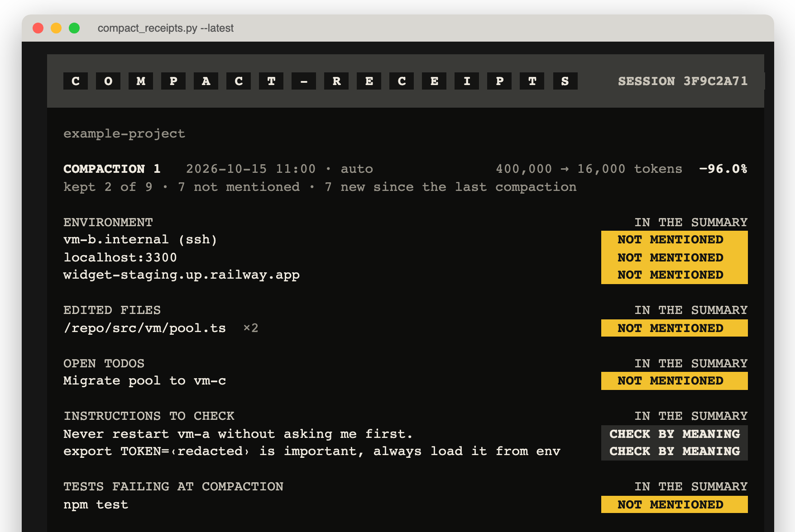
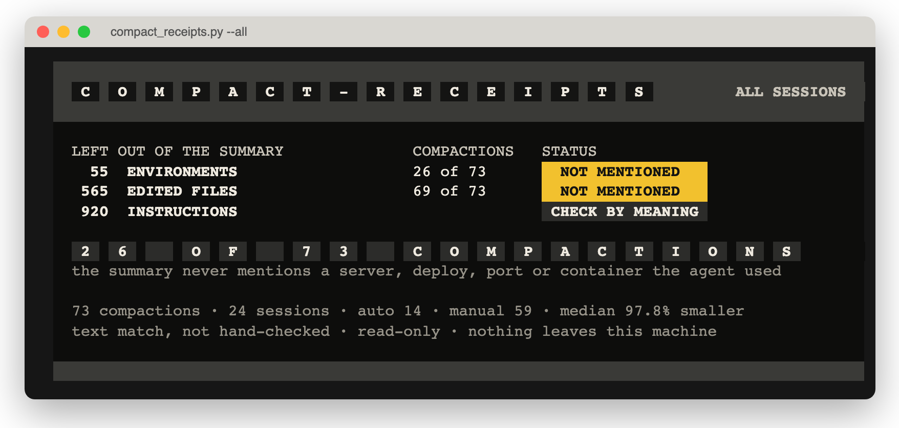

# Receipts

Open-source agent skills for Claude Code, Codex and OpenClaw. Every skill ships with receipts.

**Follow new drops:** Watch → Custom → Releases on this repo. Each release says what the skill does, its numbers, and what broke on the way.

[Русская версия](README.ru.md)

## Skills

<!-- skills:start -->
| Skill | What it does | Receipts | Runs / sends / fetches |
| --- | --- | --- | --- |
| [compact-receipts](skills/compact-receipts/SKILL.md) | Shows what a context compaction dropped: servers, deployments and ports, edited files, open todos, your earlier instructions. | [gate report](releases/compact-receipts/gate-report.json) | runs a local Python script · sends nothing · fetches nothing |
<!-- skills:end -->

Each row links to the skill folder and its gate report, which names how the skill was checked.

### compact-receipts

**Receipts #01.** Claude Code compacts long sessions, and since 2.1.299 also idle ones. The summary keeps the big picture and quietly leaves out details: the server or VM the agent was on, files it already changed, open todos, things you said at the start. `compact-receipts` prints a receipt of what each compaction left out.


<sub>Synthetic example session.</sub>

**Measured on the author's own sessions** (73 compactions in 24 sessions, median size reduction 97.8%): in 26 compactions the summary did not mention at least one environment the agent had been working with (55 in total); in 69 it did not mention files the agent had edited (565 in total). These are text checks: "not mentioned" is not the same as "mattered".



```bash
npx skills add baurrustem/receipts --skill compact-receipts
```
Then ask your agent "what did the last compaction drop?". Without an agent, from a clone of this repo:
```bash
python3 skills/compact-receipts/scripts/compact_receipts.py --latest            # last compacted session
python3 skills/compact-receipts/scripts/compact_receipts.py --all --since 30d   # audit
```
In a terminal it prints the board above. Piped, or run by the agent, it prints plain text; `--color never` or `NO_COLOR=1` forces plain text, `--json` gives everything.

Optional: a SessionStart hook with matcher `compact` running `compact_receipts.py --hook` puts the dropped environments, files and todos back into context right after each compaction. Instructions are not injected automatically; the skill asks the agent to check them by meaning first.

**Track:** tool (unit tests and a field audit on the author's sessions). A with/without comparison on agent tasks has not been run yet.

**Limits (v0.1):** Claude Code transcripts only (Codex next). Environment detection covers ssh-family targets, IPs, localhost ports, docker containers, common VM CLIs and deploy hosts (railway, fly, vercel, render and similar); third-party APIs are ignored on purpose. Instruction matching is word-based and only nominates candidates.

**Runs / sends / fetches:** runs a local Python 3.9+ script (stdlib only) that reads `~/.claude/projects`; sends nothing; fetches nothing.

## Every skill ships with receipts

Every release says how it was checked, with the numbers and the limits side by side. There are three tracks; each skill names its track in its gate report:

- **Behavioral: with vs without.** For skills that change what an agent does. The same cases run with the skill installed and without it: same model, same prompts, a fresh session per run. At least 20 runs per arm before a number appears here or in a post (smaller samples are labeled *exploratory*), the success rate of each arm with the difference and a 95% confidence interval ([`scripts/eval_stats.py`](scripts/eval_stats.py)), and near-miss prompts that should not trigger the skill, with the false-trigger rate next to the hit rate.
- **Visual: blinded human rating.** For skills whose output is judged by eye. Raters do not know which arm produced what.
- **Tool: unit tests and a field audit.** For skills built around a deterministic tool. Unit tests on synthetic data, then the tool run on real data with aggregate numbers only, and what was not measured said out loud.

Raw logs and summaries live under `evals/<skill>/runs/` and `releases/<skill>/gate-report.json`, so every number can be recomputed. No measurable result on its track, no release.

Full protocol: [evals/README.md](evals/README.md).

## Install

Replace `<skill-name>` with a name from the table.

### Claude Code: the whole collection as a plugin

```bash
claude plugin marketplace add baurrustem/receipts
claude plugin install receipts@receipts
```

Inside a session: `/plugin marketplace add baurrustem/receipts`, then `/plugin install receipts@receipts`. Skills show up as `/receipts:<skill-name>`. To stay on a release, add the marketplace at a tag: `claude plugin marketplace add baurrustem/receipts@<tag>`.

### One skill, any agent: the skills CLI

```bash
npx skills add baurrustem/receipts --list
npx skills add baurrustem/receipts --skill <skill-name>
```

Add `-a <agent>` to target one agent (`claude-code`, `codex`, `openclaw`, `cursor`, ...) and `-g` to install for your user instead of the current project.

### Codex

```bash
npx skills add baurrustem/receipts --skill <skill-name> -a codex
```

Or copy the folder yourself: Codex reads skills from `.agents/skills/` in a repo and from `~/.agents/skills/` for your user.

### OpenClaw

```bash
npx skills add baurrustem/receipts --skill <skill-name> -a openclaw
```

Or copy the folder into `<workspace>/skills/` (one workspace) or `~/.openclaw/skills/` (all local agents).

### By hand, any runtime

```bash
git clone https://github.com/baurrustem/receipts
cp -R receipts/skills/<skill-name> ~/.claude/skills/    # or ~/.agents/skills/, ~/.openclaw/skills/
```

A skill is a Markdown file plus, at most, a few small scripts. Read it before you install it.

<!--
TODO-verify: install lines below are NOT confirmed against official docs yet. Test each one before moving it above.
  codex plugin marketplace add baurrustem/receipts        # third-party write-ups say Codex also reads .claude-plugin/marketplace.json
  $skill-installer install https://github.com/baurrustem/receipts/tree/main/skills/<skill-name>   # Codex built-in installer; docs say it writes to ~/.codex/skills
  openclaw skills install skills-sh:baurrustem/receipts/<skill-name>   # syntax is in OpenClaw docs; resolution in a multi-skill repo is undocumented
  openclaw skills install @baurrustem/<skill-name>        # only after the skill is published on ClawHub
  copilot plugin marketplace add baurrustem/receipts       # Copilot CLI
  gemini skills install https://github.com/baurrustem/receipts --path skills/<skill-name> --consent   # Gemini CLI
  gh skill install baurrustem/receipts <skill-name>@<tag>  # gh CLI
-->

## What it runs / sends / fetches

Every skill's `SKILL.md` ends with a section of that name, in plain words:

- **Runs:** every command or script the agent executes, with exact versions (`npx some-cli@1.2.3`, never a bare `npx some-cli`).
- **Sends:** every host that receives data, and which data. "Nothing" is a valid answer, and the usual one.
- **Fetches:** every host it downloads from.
- **Secrets:** the environment variables it reads, if any. Keys never live in skill files.

CI rejects a skill without this section and flags every URL whose host the section does not list.

## Security posture

Agent skills run with your agent's permissions, so this repo treats them like code you execute:

- Plain text only: no binaries or compiled files in skill folders.
- No test files inside skill folders (`conftest.py`, `test_*.py`, `*.test.ts`), so your test runner never executes something you did not write.
- No `curl ... | sh`, no install hooks, no `.env` or `.npmrc` files.
- No hidden Unicode (bidirectional controls, zero-width characters) that could hide instructions from a human reviewer.
- `npx` / `uvx` pinned to exact versions.
- No telemetry. Skills do not phone home, to me or to anyone else.
- Every push and pull request runs [`scripts/validate_skills.py`](scripts/validate_skills.py) and gitleaks. GitHub Actions are pinned to full commit SHAs.
- Each release gets a manual security review, recorded in its gate report.

Found a problem? Report it privately: [SECURITY.md](SECURITY.md).

## Add a skill (maintainers)

```bash
python3 scripts/new_skill.py <skill-name>        # scaffolds skills/<skill-name>/ and evals/<skill-name>/
python3 scripts/validate_skills.py               # spec + safety checks, exit 1 on errors
python3 scripts/eval_stats.py evals/<skill-name>/runs/results.jsonl
```

## Disclosure

I'm Baur Rustem, founder of [Relog](https://relog.ai), and I build other AI products. If a skill relates to something I sell, its README says so on the first screen. No skill here requires a product of mine or sends data to one.

I have no token or coin. Anything using my name to sell one is a scam.

## License

MIT, see [LICENSE](LICENSE). Changes: [CHANGELOG.md](CHANGELOG.md).
